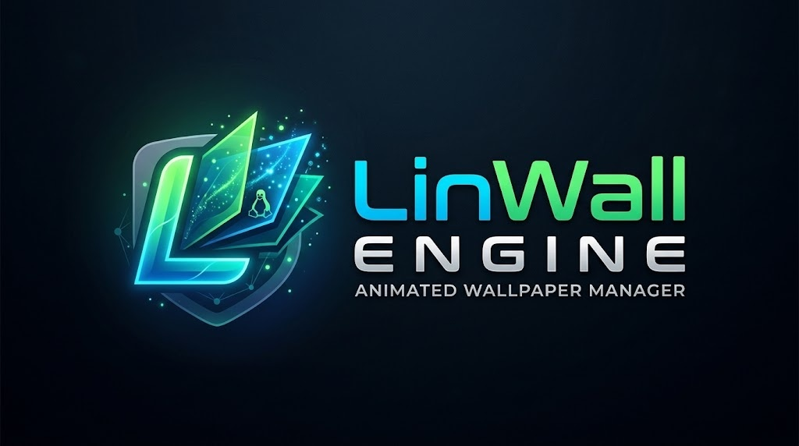

<div align="center">



# LinWall Engine v1.6.0

**Cliente gráfico nativo para usar todos tus fondos de Wallpaper Engine (Steam Workshop `431960`) en Linux con un solo clic.**  
**Native Linux GUI client to run all your Steam Wallpaper Engine (`431960`) live wallpapers with a single click.**

[-FCC624?style=for-the-badge&logo=linux&logoColor=black)](https://www.kernel.org/)
[](https://www.python.org/)
[-4A86CF?style=for-the-badge&logo=gnome&logoColor=white)](https://www.gtk.org/)
[](https://steamcommunity.com/app/431960/workshop/)
[](LICENSE)
[](#créditos-y-autoría--credits--authorship)

[**🇪🇸 Español**](#-español) · [**🇬🇧 English**](#-english) · [**📦 Instalación / Install**](#-instalación-en-1-comando--1-command-installation) · [**👤 Créditos / Credits**](#créditos-y-autoría--credits--authorship)

</div>

---

## 🇪🇸 Español

### ¿Qué problema resuelve?

**Wallpaper Engine** en Steam está diseñado para Windows y no funciona de forma nativa en escritorios Linux. En distribuciones como **Linux Mint (Cinnamon, XFCE, MATE)**, **Ubuntu**, **Debian** o **Arch Linux**, los gestores de escritorio (`nemo-desktop`, `xfdesktop`, `caja`) crean una ventana opaca a pantalla completa sobre la ventana raíz (`root window`) de X11 que tapa o bloquea los motores de fondos animados tradicionales.

**LinWall Engine v1.6.0** soluciona este problema de raíz con una interfaz gráfica oscura inspirada en Steam y un **motor híbrido inteligente**:
* Detecta automáticamente todos los fondos a los que estás suscrito en **Steam Workshop (`431960`)**.
* Gestiona de forma limpia y **100% reversible** la capa del escritorio (`_NET_WM_WINDOW_TYPE_DESKTOP` + `_NET_WM_STATE_BELOW` + región XFixes `ShapeInput` transparente a clics y ocultación opcional de iconos).
* Funciona con o sin iconos de escritorio visibles y restaura tu fondo automáticamente al iniciar sesión.

### Características principales

* **Escáner automático de Steam Workshop (`431960`):**
  * Busca en instalaciones de Steam nativas (`~/.steam/steam`, `~/.local/share/Steam`), Flatpak (`~/.var/app/com.valvesoftware.Steam/...`), Snap y discos secundarios declarados en `libraryfolders.vdf`.
  * Parser tolerante de `project.json` (UTF-8 con/sin BOM, UTF-16, Windows-1252, Latin-1) y carga de miniaturas en caché (`~/.cache/linwall/thumbs/`) con soporte para `.jpg`, `.png`, `.webp` y GIFs animados.
* **Motor Híbrido (`VIDEO` + `SCENE` + `WEB`) con Fallbacks Automáticos (v1.6.0):**
  * **Fondos `VIDEO` y `.gif` (`.mp4`, `.webm`, `.avi`, `.mkv`, `.gif`):** Renderizados con `xwinwrap` + `mpv` con aceleración por hardware (`--hwdec=auto`), bucle infinito (`--loop-file=inf`) y control de volumen/silencio en caliente vía socket UNIX IPC.
  * **Fondos `SCENE` y `WEB` (`scene.pkg`, `scene.json`, `index.html`):** Renderizados con `linux-wallpaperengine` (`--no-fullscreen-pause`, `--scaling fill`). Si el modo `--screen-root` choca con el gestor de escritorio o falla, activa automáticamente el modo ventana sin bordes (`--window 0x0x<ANCHO>x<ALTO>`) anclado a `_NET_WM_WINDOW_TYPE_DESKTOP` y `_NET_WM_STATE_BELOW`, y si una escena específica no es compatible, recurre automáticamente a `xwinwrap` + `mpv` sin crashear jamás.
* **Compatibilidad nativa con Escritorios Linux (Cinnamon, XFCE, MATE):**
  * Switch en tiempo real para ocultar o mostrar la capa de iconos del escritorio (`gsettings` en Cinnamon/MATE, `xfdesktop --quit` en XFCE), restaurando siempre el estado original al detener el fondo.
* **Persistencia y Autostart ligero:**
  * Guarda tus ajustes en `~/.config/linwall/config.json` y genera `~/.config/autostart/linwall-restore.desktop` para restaurar el último fondo al iniciar sesión (`linwall --restore`) sin abrir la ventana principal.

---

## 🇬🇧 English

### What problem does it solve?

Steam's **Wallpaper Engine** is built for Windows and does not run natively on Linux desktops. On distributions like **Linux Mint (Cinnamon, XFCE, MATE)**, **Ubuntu**, **Debian**, or **Arch Linux**, desktop managers (`nemo-desktop`, `xfdesktop`, `caja`) draw an opaque full-screen window over the X11 root window that covers or crashes traditional live-wallpaper tools.

**LinWall Engine v1.6.0** solves this out of the box with a sleek Steam-inspired dark GTK 3 interface and a **smart hybrid rendering engine**:
* Automatically discovers every wallpaper subscribed in **Steam Workshop (`431960`)**.
* Cleanly and **reversibly** manages the X11 desktop layer (`_NET_WM_WINDOW_TYPE_DESKTOP` + `_NET_WM_STATE_BELOW` + click-through XFixes `ShapeInput` region + optional desktop icon layer toggle).
* Works seamlessly whether desktop icons are visible or hidden, and automatically restores your live wallpaper at login.

### Key Features

* **Automatic Steam Workshop Scanner (`431960`):**
  * Scans native Steam paths (`~/.steam/steam`, `~/.local/share/Steam`), Flatpak (`~/.var/app/com.valvesoftware.Steam/...`), Snap, and secondary Steam libraries parsed from `libraryfolders.vdf`.
  * Fault-tolerant `project.json` parser (UTF-8/BOM, UTF-16, Windows-1252, Latin-1) and multi-threaded cached thumbnail loader (`~/.cache/linwall/thumbs/`) supporting `.jpg`, `.png`, `.webp`, and animated `.gif` previews.
* **Hybrid Rendering Engine (`VIDEO` + `SCENE` + `WEB`) with Multi-Stage Fallbacks (v1.6.0):**
  * **`VIDEO` & `.gif` Wallpapers (`.mp4`, `.webm`, `.avi`, `.mkv`, `.gif`):** Powered by `xwinwrap` + `mpv` with hardware decoding (`--hwdec=auto`), infinite looping (`--loop-file=inf`), and real-time volume/mute control over mpv's UNIX IPC socket.
  * **`SCENE` & `WEB` Wallpapers (`scene.pkg`, `scene.json`, `index.html`):** Powered by `linux-wallpaperengine` (`--no-fullscreen-pause`, `--scaling fill`). Automatically falls back from `--screen-root` to borderless monitor-sized window mode (`--window 0x0x<WIDTH>x<HEIGHT>`) pinned with `_NET_WM_WINDOW_TYPE_DESKTOP` and `_NET_WM_STATE_BELOW`, and falls back to `xwinwrap` + `mpv` if a specific scene shader is unsupported—ensuring it never crashes.
* **First-Class Desktop Environment Integration (Cinnamon, XFCE, MATE):**
  * Built-in toggle to hide or restore the native desktop icon layer (`gsettings` on Cinnamon/MATE, `xfdesktop --quit` on XFCE).
* **Persistence & Lightweight Autostart:**
  * Saves user settings to `~/.config/linwall/config.json` and creates `~/.config/autostart/linwall-restore.desktop` to restore your last active wallpaper on login (`linwall --restore`) without opening the GUI.

---

## 📦 Instalación en 1 comando / 1-Command Installation

### Debian / Ubuntu / Linux Mint

```bash
git clone https://github.com/walterguerrero/linwall-engine.git && cd linwall-engine && chmod +x install.sh && ./install.sh
```

> **Opciones del instalador / Installer flags:**
> * `./install.sh` — Instala dependencias con `apt`, compila `xwinwrap` y `linux-wallpaperengine` en `~/.local/share/linwall/bin/` y crea el lanzador en el menú de aplicaciones.
> * `./install.sh --skip-lwe` — Instalación rápida (solo instala `mpv` + `xwinwrap` para fondos tipo `VIDEO` y `.gif`).
> * `./install.sh --force-build` — Fuerza la recompilación de los motores nativos.

### Ejecución directa / Run directly from source

```bash
python3 -m linwall
```

### Comandos CLI / CLI Reference

```bash
linwall                  # Abre la interfaz gráfica / Launch the GTK 3 GUI
linwall --status         # Estado del motor, escritorio y binarios / Engine & desktop status
linwall --list           # Lista los fondos de Workshop 431960 / List discovered wallpapers
linwall --apply <ID>     # Aplica un fondo por su ID o ruta / Apply wallpaper by ID or path
linwall --restore        # Restaura el último fondo activo / Restore last active wallpaper
linwall --stop           # Detiene el fondo y restaura el escritorio / Stop & restore desktop
```

---

## Estructura del Proyecto / Project Structure

```text
linwall-engine/
├── install.sh              # Instalador todo-en-uno / All-in-one installer (apt + build + .desktop)
├── LICENSE                 # Licencia oficial GNU GPL v3.0 / Official GNU GPL v3.0 License
├── README.md               # Documentación bilingüe (ES/EN) / Bilingual documentation
├── .gitignore              # Exclusiones de Git / Git ignore rules
└── linwall/
    ├── __init__.py         # Metadatos v1.6.0 y créditos oficiales / Metadata & credits
    ├── __main__.py         # Punto de entrada: python3 -m linwall
    ├── paths.py            # Rutas XDG y detección de Steam / XDG paths & Steam discovery
    ├── config.py           # Configuración en ~/.config/linwall/config.json
    ├── scanner.py          # Escáner de Workshop 431960 y parser de project.json
    ├── monitors.py         # Detección multimonitor vía xrandr --listmonitors
    ├── desktop.py          # Integración con Cinnamon (nemo-desktop), XFCE (xfdesktop) y MATE (caja)
    ├── x11.py              # Anclaje X11 (_NET_WM_WINDOW_TYPE_DESKTOP, _NET_WM_STATE_BELOW, ShapeInput)
    ├── pkg.py              # Desempaquetador de scene.pkg (PKGV) y limpiador de capas en scene.json
    ├── engine.py           # Motor híbrido (xwinwrap + mpv / linux-wallpaperengine) con fallbacks
    ├── autostart.py        # Autostart en ~/.config/autostart/linwall-restore.desktop
    ├── cli.py              # Interfaz de línea de comandos / CLI interface
    └── gui/
        ├── __init__.py
        ├── app.py          # Gtk.Application y proveedor CSS oscuro
        ├── window.py       # Ventana principal, cuadrícula FlowBox, panel lateral y modal Acerca de
        ├── card.py         # Tarjeta visual de cada fondo con insignias VIDEO / SCENE / WEB
        ├── thumbs.py       # Cargador multihilo y caché de miniaturas (JPG/PNG/WebP/GIF)
        ├── style.css       # Tema oscuro estilo Steam / Wallpaper Engine
        └── linwall.svg     # Icono vectorial oficial / Official SVG icon
```

---

## Créditos y Autoría / Credits & Authorship

<div align="center">

**Desarrollado con orgullo desde Paraguay 🇵🇾 por Walter Guerrero**  
*Proudly developed in Paraguay 🇵🇾 by **Walter Guerrero***

| Rol / Role | Detalle / Details |
| :--- | :--- |
| **Autor / Creador (Creator & Lead Developer)** | **Walter Guerrero** (Paraguay 🇵🇾) |
| **Contacto / Contact Email** | [walteguerrerob@gmail.com](mailto:walteguerrerob@gmail.com) |
| **Colaboración de Arquitectura e IA (AI & Architecture)** | **Gemini (Google AI) & Claude** |
| **Motores comunitarios integrados (Upstream Engines)** | [`mpv`](https://mpv.io/), [`ujjwal96/xwinwrap`](https://github.com/ujjwal96/xwinwrap), [`Almamu/linux-wallpaperengine`](https://github.com/Almamu/linux-wallpaperengine) |
| **Licencia / License** | [GNU General Public License v3.0 (GPL-3.0)](LICENSE) |

</div>
